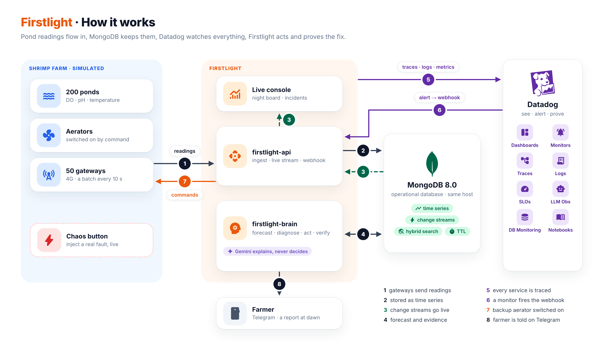

# Firstlight

**Every pond makes it to morning.**

Oxygen in a shrimp pond bottoms out just before dawn. Firstlight runs the night shift: it forecasts how many minutes each pond has before it runs short of oxygen, tells a pond in trouble from a fouled sensor or a dropped gateway, acts within seconds, and proves the pond recovered. Built on MongoDB and Datadog.

Built for [MUGVN Hackathon 2026: Real-time Operations](https://mini-hackathon-sep-2026.mugvn.com/).
The build window runs from 17 to 31 October 2026; the application code lands in this repository during that window.

**Live demo:** <https://167-104-100-185.sslip.io>. 200 simulated ponds on 50 farms run around the clock on Vietnam time. The console is read-only; the chaos panel, which injects real faults, asks for a demo code.

## What it does

- **Forecasts every pond every 10 s.** One MongoDB aggregation fits the oxygen trend of all 200 ponds in 345 ms. It restarts the fit when an aerator stops or a probe is cleaned, and gives the minutes left before the pond drops below 3 mg/L.
- **Tells the pond from the probe and the data path.** Weighted evidence from aerator current, pH, probe quality, physics, neighbouring ponds, gateway freshness and recent releases gives a cause and a confidence. A fouled probe is a false alarm stopped, not a farmer woken at 2 a.m.
- **Acts within seconds and proves recovery.** Playbooks send commands through a change-stream command bus, and the gateway acknowledges each one. On the demo, an aerator failure was detected in 5 s and the standby was turning 1 s later. The pond never dropped below 4.55 mg/L and the incident was resolved in 2.2 minutes, with lead time, MTTR and oxygen debt computed in MongoDB.
- **Keeps the farmer in the loop.** One plain Vietnamese message on Telegram, with an acknowledge button and escalation if nobody answers. A dawn report at 06:00 shows what the night held and the value of the shrimp it protected.
- **Uses AI where it is safe.** Gemini investigates with read-only tools, after the rules have decided. It recalls similar past incidents through hybrid vector and keyword search, and every answer is scored: on the demo it matched the injected fault 8 times out of 8, and every answer was grounded.




## Documentation

- [Architecture](docs/ARCHITECTURE.md): components, flows, failure modes, deployment
- [MongoDB data model](docs/MONGODB-DATA-MODEL.md): collections, lifecycle, aggregation pipelines
- [Datadog observability](docs/DATADOG-OBSERVABILITY.md): tags, monitors, SLOs, dashboards, webhook
- [Incident scenarios](docs/INCIDENT-SCENARIOS.md): the five incidents the demo triggers
- [Declaration](docs/DECLARATION.md): reused components, data and AI tools

## Run it

Requirements: Docker with Compose v2, [uv](https://docs.astral.sh/uv/), Node 22 or newer.

```bash
make up          # first run creates .env from .env.example; COMPOSE_PROFILES picks what starts
make test        # unit tests (set MONGODB_URI to also run the MongoDB integration tests)
make lint        # ruff, mypy and the web typecheck
```

| Profile | Starts |
|---|---|
| `localdb` | MongoDB 8.0 (`mongodb/mongodb-atlas-local`), with Atlas Search and Vector Search |
| `datadog` | Datadog Agent (needs `DD_API_KEY` and `DD_SITE`) |
| `app` | `api`, `brain`, `edge`, `web` |
| `proxy` | Caddy with automatic HTTPS for `PUBLIC_HOST` |

The demo host runs `localdb,app,proxy`, plus `datadog` once the account is active, and is deployed with `scripts/deploy.sh`. `scripts/measure.py` times the queries and storage of a running deployment, and `scripts/loadtest.sh` runs a second stack at ten times the demo's farms.

## Repository conventions

- `docs/` holds the public technical documentation.
- Commits follow [Conventional Commits](https://www.conventionalcommits.org/). Enable the hooks once per clone:

  ```bash
  git config core.hooksPath scripts/hooks
  ```

  `pre-commit` refuses credentials and anything under `private/`; `commit-msg` checks the subject line.
