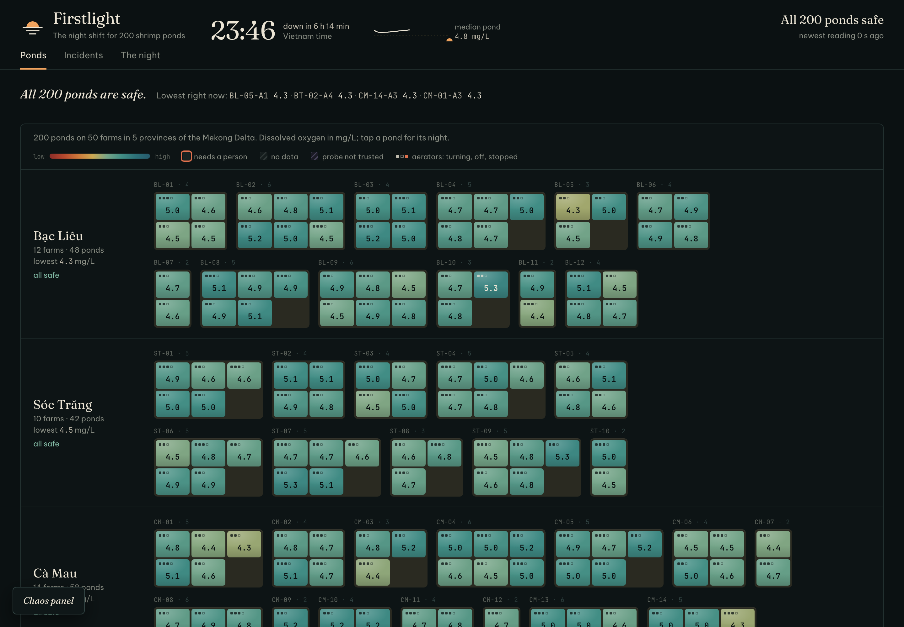
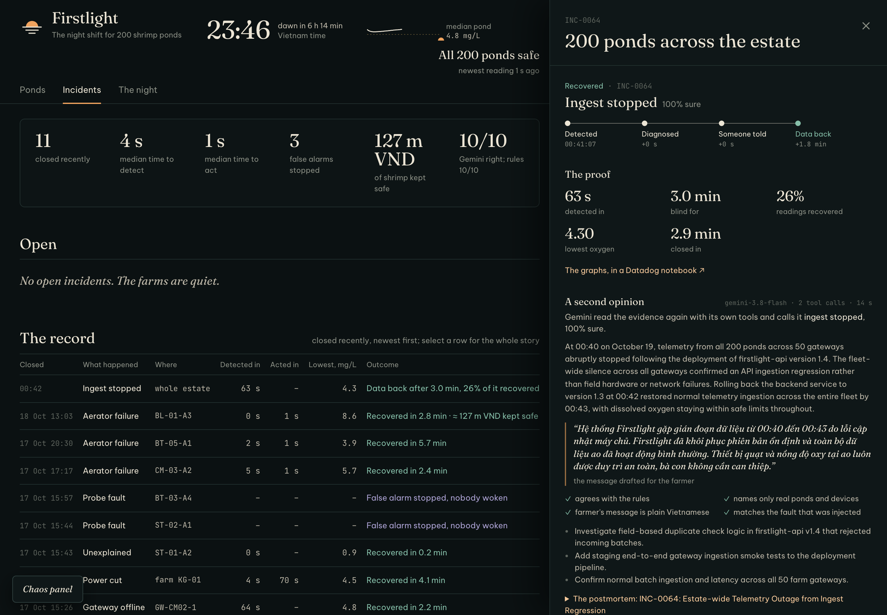
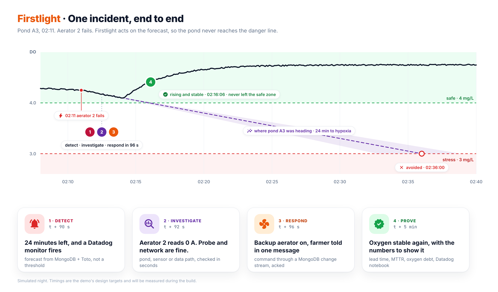

# Firstlight

**Every pond makes it to morning.**

Oxygen in a shrimp pond bottoms out just before dawn. Firstlight runs the night shift: it forecasts how many minutes each pond has before it runs short of oxygen, tells a pond in trouble from a fouled sensor or a dropped gateway, acts within seconds, and proves the pond recovered. Built on MongoDB and Datadog.

Built by team Night Shift for [MUGVN Hackathon 2026: Real-time Operations](https://mini-hackathon-sep-2026.mugvn.com/).
The code in this repository was written in the build window, 17 to 31 October 2026; what was prepared before it is listed in the [declaration](docs/DECLARATION.md).

**Live demo:** <https://167-104-100-185.sslip.io>. 200 simulated ponds on 50 farms run around the clock on Vietnam time. The console is read-only; the chaos panel, which injects real faults, asks for a demo code.



## The problem

Dissolved oxygen in a shrimp pond falls through the night. At dusk the algae stop producing oxygen, while the shrimp, the algae and the bacteria keep breathing, so the lowest point comes just before dawn. Aerators keep the pond alive until then, and when one fails the pond can run short within the hour: in the simulator, 19 of 20 ponds that lost their main aerator fell below 3 mg/L, where white-leg shrimp start to suffer, inside an hour.

Most pond alarms fire on a threshold. They go off once the oxygen is already low, and just the same when a probe is fouled or a gateway loses its 4G link, so the farmer is woken at 2 a.m. for nothing. Nobody can watch hundreds of ponds all night, and a 3,000 m² pond at day 90 holds about 5 tonnes of shrimp, worth about 575 million VND.

## Use case

Firstlight watches every pond of a farm or a cooperative through the night, for the people who would otherwise have to stay awake:

| Who | What they get |
|---|---|
| The farmer | one plain Vietnamese message on Telegram saying what happened and what was done, an acknowledge button, and a report at dawn |
| The technician | a ticket for the aerator to repair, the probe to clean or the gateway to check, with its evidence |
| The engineer running the platform | the console and Datadog, and when the software itself fails, a message naming the release to roll back to |

A night on the demo: at 03:19 the main aerator of pond BL-01-A3 stopped. Five seconds later Firstlight had opened an incident, ruled out the probe, the data path and a power cut, and started the standby aerator, which the gateway confirmed a second later. The owner got one message. The pond never went below 4.55 mg/L, and the incident closed 2.2 minutes after the fault, with its proof written to a Datadog notebook. Later that night a fouled probe was recognised as a false alarm, and nobody was woken.

It is meant for those who already reach the ponds: aquaculture IoT vendors adding monitoring and automatic response to the probes and gateways they install, cooperatives that want one screen for many farms and a dawn report for each owner, and agricultural insurers who need each incident's data and proof of recovery.

## What it does

- **Forecasts every pond every 10 s.** One MongoDB aggregation fits the oxygen trend of all 200 ponds in 345 ms. It restarts the fit when an aerator stops or a probe is cleaned, and gives the minutes left before the pond drops below 3 mg/L.
- **Tells the pond from the probe and the data path.** Weighted evidence from aerator current, pH, probe quality, physics, neighbouring ponds, gateway freshness and recent releases gives a cause and a confidence. A fouled probe is a false alarm stopped, not a farmer woken at 2 a.m.
- **Acts within seconds and proves recovery.** Playbooks send commands through a change-stream command bus, and the gateway acknowledges each one. On the demo, an aerator failure was detected in 5 s and the standby was turning 1 s later. The pond never dropped below 4.55 mg/L and the incident was resolved in 2.2 minutes, with lead time, MTTR and oxygen debt computed in MongoDB. Each closed incident writes its proof, graphs included, to a Datadog notebook.
- **Keeps the farmer in the loop.** One plain Vietnamese message on Telegram, with an acknowledge button and a reminder if nobody answers within 3 minutes. A dawn report at 06:00 shows what the night held and the value of the shrimp it protected.
- **Uses AI where it is safe.** Gemini investigates with read-only tools, after the rules have decided. It recalls similar past incidents through hybrid vector and keyword search, and every answer is scored: on the demo it matched the injected fault 14 times out of 14, and every answer named only real ponds and devices.






## Documentation

- [Architecture](docs/ARCHITECTURE.md): components, flows, failure modes, deployment
- [MongoDB data model](docs/MONGODB-DATA-MODEL.md): collections, lifecycle, aggregation pipelines
- [Datadog observability](docs/DATADOG-OBSERVABILITY.md): tags, monitors, SLOs, dashboards, webhook
- [Incident scenarios](docs/INCIDENT-SCENARIOS.md): the five incidents the demo triggers, each through detect, investigate and resolve, with measured runs
- [Capacity and cost](docs/CAPACITY-AND-COST.md): a load test at five times the demo, and the cost per pond
- [Declaration](docs/DECLARATION.md): reused components, data and AI tools

## Run it

Requirements: Docker with Compose v2, [uv](https://docs.astral.sh/uv/), Node 22 or newer.

```bash
make up          # first run creates .env from .env.example; COMPOSE_PROFILES picks what starts
make test        # unit tests (set MONGODB_URI to also run the MongoDB integration tests)
make lint        # ruff, mypy and the web typecheck
```

Nothing else is needed to run it end to end: the simulator, ingest, forecasts, incidents and the console work without any key. `GEMINI_API_KEY` adds the AI investigator, `DD_API_KEY` and `DD_APP_KEY` with the `datadog` profile add telemetry and the incident notebooks, the `TELEGRAM_*` settings add messages to the farmer, and `VITE_DD_RUM_*` switch on RUM in the console.

| Profile | Starts |
|---|---|
| `localdb` | MongoDB 8.0 (`mongodb/mongodb-atlas-local`), with Atlas Search and Vector Search |
| `datadog` | Datadog Agent (needs `DD_API_KEY` and `DD_SITE`) |
| `app` | `api`, `brain`, `edge`, `web` |
| `proxy` | Caddy with automatic HTTPS for `PUBLIC_HOST` |

The demo host runs `localdb,app,proxy,datadog` and is deployed with `scripts/deploy.sh --ci` (CI's images, tagged with the git sha); `scripts/datadog-apply.sh` creates the Datadog monitors, SLOs and dashboards from `infra/datadog/`. `scripts/measure.py` times the queries and storage of a running deployment, and `scripts/loadtest.sh` runs a second stack beside the demo, at five times its farms by default.

## Repository conventions

- `docs/` holds the public technical documentation.
- Commits follow [Conventional Commits](https://www.conventionalcommits.org/). Enable the hooks once per clone:

  ```bash
  git config core.hooksPath scripts/hooks
  ```

  `pre-commit` refuses credentials and anything under `private/`; `commit-msg` checks the subject line.
