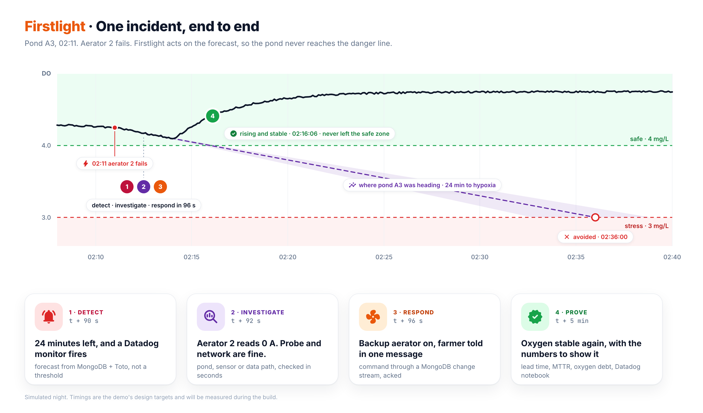
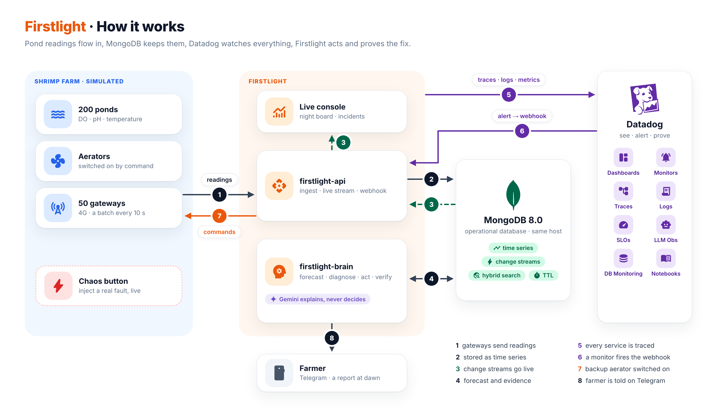
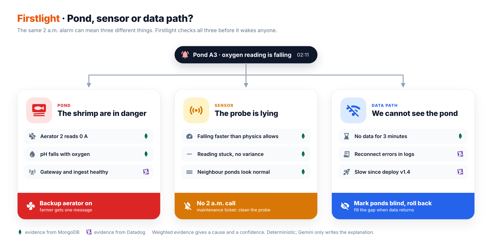
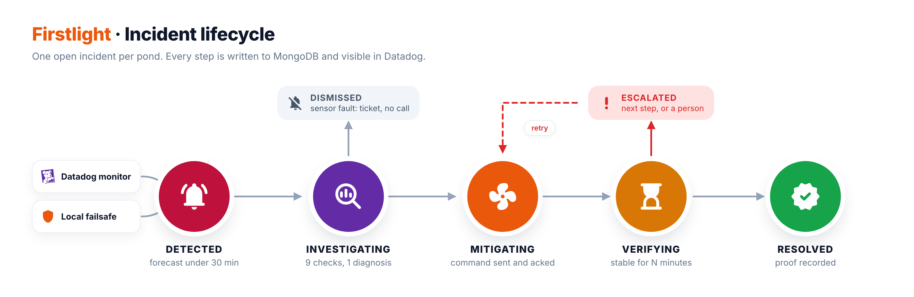
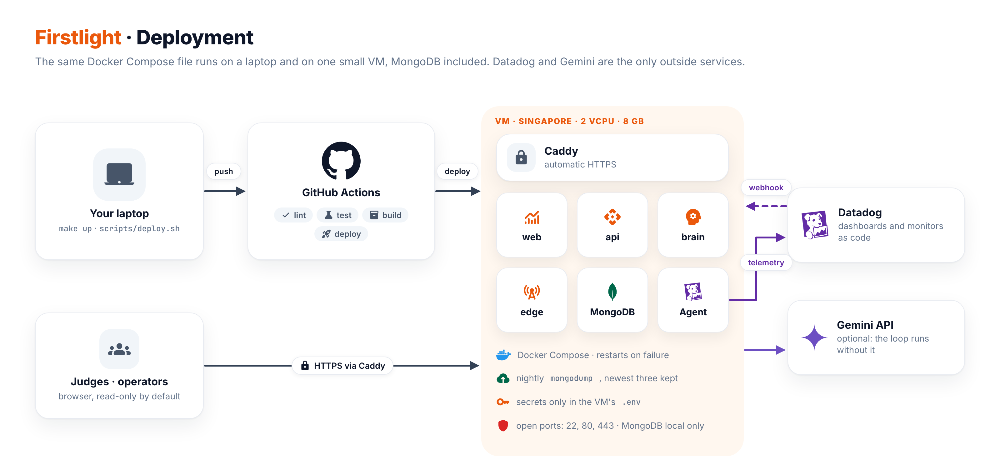

# Architecture

> **Status:** as built on 17/10/2026. Numbers come from the demo host unless marked *target*. Datadog is live on a test org: APM, logs, metrics and LLM Observability from every service, with monitors, SLOs and dashboards kept as code in `infra/datadog/`. The brain's own detection does not depend on it: everything described here also runs with Datadog unreachable.

Firstlight runs the night shift for shrimp ponds. It forecasts how many minutes each pond has before it runs short of oxygen. It works out whether an alarm comes from the pond, the probe or the data path, acts within seconds, and proves the pond recovered.



---

## 1. System at a glance



| Component | Role | Runs as |
|---|---|---|
| **firstlight-edge** | Simulated farms: 200 ponds on 50 farms of two to six ponds each, spread unevenly over five provinces as the Delta's shrimp farms are (Cà Mau 14 farms, Kiên Giang 6), with 688 aerators (200 of them standby) and one 4G gateway per farm. A physics model of dissolved oxygen (DO) drives each pond. Gateways store and forward, obey commands, and start a standby aerator on their own when DO reads below 3.5 mg/L. A control port, reachable only inside the compose network, injects real faults for the demo. | Python process |
| **firstlight-api** | Ingests gateway batches. Streams live state to consoles and commands to gateways over SSE. Receives the Datadog and Telegram webhooks. Serves incidents, the dawn report and the chaos panel. | FastAPI |
| **firstlight-brain** | Every 10 s: forecasts every pond, opens and investigates incidents, runs playbooks, verifies recovery and writes the record. It also rolls data up, delivers notifications, writes the dawn report and runs the AI investigator. | Python worker |
| **firstlight-web** | The operator console. It opens on the ponds: every pond of the estate coloured by its oxygen, with what needs a person above them. Two more tabs hold the incidents (open ones as tracks from detection to recovery, closed ones as a record) and the night (the estate's oxygen from dusk to dawn, the dawn report and the AI's score). Drawers explain a pond or an incident; the chaos panel injects faults. | React (Vite) |
| **MongoDB 8.0** | Operational database: time series readings, live state, the command bus, incidents and incident memory, with Atlas Search and Vector Search. | `mongodb/mongodb-atlas-local:8.0.34` on the same host; the code runs unchanged on Atlas by changing `MONGODB_URI` |
| **Datadog** | APM, logs, DogStatsD metrics, RUM and LLM Observability. Its monitors call the webhook. | Managed (SaaS) |
| **Gemini on Vertex AI** | Investigates each incident with read-only tools. Writes the summary, the farmer's message and the postmortem, and embeds closed incidents for memory. It never decides an action. | `gemini-3.8-flash`, falling back to `gemini-3.5-flash`; `gemini-embedding-2` |
| **Telegram** | Messages to the farmer with an acknowledge button. Escalation when nobody acknowledges. | Bot API |

## 2. Design principles

1. **Right data, right place.** MongoDB keeps every reading at full resolution, plus every command and every incident. Datadog receives low-cardinality signals: one series per pond or gateway, plus the software's own traces, logs and metrics. Its cost grows with the number of ponds, not with the number of readings.
2. **Treat each pond as a service.** The SLI is `minutes_to_hypoxia`. The SLO is "oxygen safety" per pond: the share of pond-minutes at 4 mg/L or more. Each incident gets an MTTD, an MTTR and a postmortem: SRE practice applied to a living system.
3. **AI stays off the critical path.** Detection, diagnosis and safe actions are deterministic and take seconds. The gateway has its own failsafe for when the cloud is out of reach. Gemini explains and drafts, and each answer is scored.

## 3. Main flows

### A. Telemetry (every 10 s)

1. A gateway samples its ponds every 10 s and posts a batch to `POST /v1/ingest` with a `batch_id` and a sequence number. When its 4G link is down, it keeps the batches and sends them oldest first once the link returns.
2. The API claims the `batch_id` in `ingest_batches`, whose `_id` is unique and which has a 1-day TTL. A retried batch is acknowledged and dropped. Time series collections cannot carry a unique index, so deduplication happens here.
3. `readings.insert_many(ordered=False)` writes one document per pond per sample. A pipeline `bulk_write` updates `pond_state.last`, but only with a newer reading, so a late backlog never rewinds it. Anything the gateway did on its own (the failsafe) goes to `events`.
4. When Datadog is on, DogStatsD emits `firstlight.pond.*` gauges tagged `farm`, `pond` and `gateway`.
5. A change stream on `pond_state` pushes the update to every console over SSE, coalesced per pond.

### B. Detection (every 10 s)

1. One aggregation fits the DO trend of every pond over the last 12 minutes. It restarts the fit when the pond's setup changes: an aerator stops, the standby starts, or the probe is cleaned. It gives `minutes_to_hypoxia` (until 3 mg/L) and `rate_3m`, and takes 345 ms for 200 ponds ([data model](MONGODB-DATA-MODEL.md#how-many-minutes-until-this-pond-runs-out-of-oxygen)).
2. Each pond gets a status, written to `pond_state` with its forecast:

   | Status | Meaning |
   |---|---|
   | `ok` | nothing to watch |
   | `watch` | under 4 mg/L, forecast under 60 minutes, or an aerator down |
   | `alert` | under 3 mg/L, or forecast under 30 minutes |
   | `sensor` | the probe is known to be wrong, so its reading is not trusted |
   | `blind` | no data for 60 s |

3. The brain opens an incident in any of these cases:
   - an aerator is switched on but draws no current;
   - the forecast is under 30 minutes, or DO is under 3 mg/L;
   - DO falls faster than 0.1 mg/L per minute over 3 minutes;
   - the probe reports degraded signal quality;
   - ponds go silent.

   Problems are grouped by scope: pond; farm (a power cut); gateway; or estate, when most gateways go silent at once. A partial unique index allows one open incident per key.
4. A Datadog alert that reaches the webhook joins the open incident for its pond, or opens one with `detected_by: datadog`.

### C. Investigation: pond, sensor or data path?



Each check returns a cause, a verdict (supporting or against) and a weight. The weighted sum gives the diagnosis and its confidence, for example `aerator_failure 0.93`.

| Plane | Check | Weight |
|---|---|---|
| Pond | an aerator switched on draws 0 A | +0.85 aerator failure |
| Pond | every aerator on the farm stops at once | +0.9 power cut, −0.3 aerator failure |
| Pond | DO falls after the aerator stopped | +0.2 |
| Pond | the other ponds on the farm are steady | −0.3 power cut |
| Sensor | DO falls more than 0.5 mg/L in 3 minutes but pH does not follow | +0.25 sensor fault; −0.2 when pH agrees |
| Sensor | the probe reports signal quality below 0.8 | +0.4 sensor fault; −0.2 at 0.95 or more |
| Sensor | DO falls faster than water can lose oxygen while every aerator turns | +0.35 sensor fault |
| Data path | one gateway's ponds are silent while the rest of the fleet reports | +0.4 and +0.4 gateway offline |
| Data path | more than half the gateways are silent at once | +0.7 ingest regression, −0.4 gateway offline |
| Data path | an API release started within 15 minutes before the data stopped | +0.35 ingest regression |
| Data path | the pond's readings arrive on time | −0.2 gateway offline |

**The rules decide; Gemini explains.** After the diagnosis, and off the critical path, Gemini receives the evidence and the three most similar past incidents. Those are found by hybrid search: vector and keyword search over closed incidents, merged with Reciprocal Rank Fusion. Gemini may call five read-only tools in at most five rounds: pond readings, gateway status, farm overview, recent deployments and past incidents. It then writes:
- a summary for the operator;
- a message for the farmer in plain Vietnamese;
- the postmortem.

Every answer is scored automatically:
- does it agree with the rules?
- is it grounded, naming only what it saw?
- is the farmer's message plain Vietnamese without jargon?
- in demo mode, does it match the fault that was actually injected?

On the demo so far, 9 incidents were investigated:
- The AI matched the injected fault 8 times out of 8, and so did the rules.
- Every answer was grounded.
- All 9 farmer messages passed.
- The one incident the rules could not explain was marked "explained unknown" rather than scored.

### D. Response: a closed loop through MongoDB

1. The diagnosis selects a playbook from `playbooks`. Each step is either `auto` or `approve`; an operator approves in the console.

   | Cause | Playbook |
   |---|---|
   | aerator failure | start the standby aerator, message the farmer, open a repair ticket |
   | power cut | start the generator (`approve`), message the farmer |
   | sensor fault | dismiss the alarm and open a cleaning ticket; nobody is woken |
   | gateway offline | message the technician, monitor, and check the backlog for gaps when data returns |
   | ingest regression | message the engineer with the release to roll back to, and monitor |
   | unknown | message the owner and escalate to a person |

2. The brain inserts each step into `commands` with `status: pending`. A command must be delivered within 2 minutes and is kept for 7 days.
3. The API holds **one** change stream on `commands` and forwards each command to the gateway's open SSE channel. A single stream, rather than one per gateway, keeps the connection pool small.
4. The gateway applies the command and calls `POST /v1/commands/{id}/ack`. The incident timeline updates, and `firstlight.command.ack_latency_ms` is recorded.
5. A command without an ack is retried after 15 s, at most three times. One that cannot be delivered within 2 minutes expires, and the incident escalates.
6. Messages wait in the incident's outbox until the notifier delivers them to Telegram. Each carries an acknowledge button and a link to the pond. If nobody acknowledges within 3 minutes, it escalates once, to the escalation chat when one is set. The time to acknowledge (MTTA) goes into the record.

### E. Proof of recovery

1. The incident is **verifying** once every command is done. The pond counts as recovered when DO is at 4 mg/L or more and not falling for 2 minutes, measured from when the last command ran: readings from before the action do not count. Without recovery after 10 minutes, the incident escalates.
2. The record is computed with aggregations:
   - MTTD, time to action, MTTR and MTTA;
   - lead time: the predicted breach minus the detection;
   - minimum DO and minutes below 4 mg/L;
   - oxygen debt, the `$integral` of (4 − DO)⁺ over time;
   - for a blind spell, how long it lasted and how much of it the backlog covered (`$densify`).
3. The closed incident is embedded with Gemini and becomes memory for the next one.
4. In demo mode the chaos registry knows the injected fault. Both the rules' diagnosis and Gemini's are scored against it, so the accuracy of the root cause is a number.

### F. Data lifecycle and the dawn report

- Every minute the brain rolls `readings` up into `readings_1m`, a time series collection like the readings, and every hour `$merge` rolls those up into `readings_1h`. The brain rolls up every complete minute after the newest one stored, so a restart leaves no hole.
- Retention:

  | Collection | Kept for |
  |---|---|
  | raw `readings` | 14 days |
  | `readings_1m` | 180 days |
  | `readings_1h` | indefinitely |
  | `commands` | 7 days |
  | `ingest_batches` | 1 day |
  | `events` | 30 days |

- At 06:00 Vietnam time the brain writes the **dawn report** for the estate, plus a page for each farm that had an incident or a pond under 4 mg/L. The report lists:
  - incidents by cause, recovered, false alarms stopped and escalations;
  - oxygen safety: the share of pond-minutes at 4 mg/L or more;
  - the lowest pond;
  - the value of the shrimp in the ponds that were protected.

  The estate summary goes to Telegram. The farmer sleeps through the night and reads it in the morning.

### G. What is at stake

Each incident carries `at_risk`: the estimated value of the shrimp in its ponds.

```
market = post-larvae stocked × survival(age) × average weight(age) × farm-gate price(size)
cost   = post-larvae stocked × 70 VND + feed eaten so far × 34,000 VND/kg
value  = the larger of the two
```

Shrimp under 6.7 g (more than 150 to the kilogram) have no farm-gate price. A young crop is therefore valued at the seed and feed spent on it. The figures come from the sources below; the full citations are in [`economics.py`](../src/firstlight/core/economics.py).

| Figure | Value | Source |
|---|---|---|
| Farm-gate prices by size | 20 to 150 shrimp per kg, 190,000 down to 64,000 VND/kg | [tepbac.com](https://tepbac.com/gia-thuy-san/gia-loai/tom-the-chan-trang) dealer quotes, 16/10/2026 |
| Growth | 17 g at day 90 | lined Mekong ponds: FAO Circular 1194 (2019), Hiền et al. (2021); Can Tho University biofloc guide |
| Survival | 65% at day 90, most losses before day 60 | Võ Nam Sơn et al. (2019); FAO (2019) |
| Stocking | 157 ± 38 post-larvae per m² | Hiền et al. (2021), 178 households |
| Feed conversion | 1.3 kg of feed per kg of shrimp | Hiền et al. (2021) |

This is the team's estimate of what an incident puts at stake, not a valuation. During 2026, prices moved by about 30% either way.

## 4. Incident lifecycle



An incident moves from `investigating` to `mitigating`, then `verifying`, then `resolved`. The other outcomes are:

| Status | When |
|---|---|
| `dismissed` | a sensor fault: a false alarm stopped |
| `monitoring` | a gateway offline or an ingest regression, waiting for data |
| `awaiting_approval` | a step such as the generator needs an operator |
| `escalated` | a command failed, the standby did not turn, or the pond did not recover |

A key has at most one open incident; later alerts for the same key join it. Each transition appends to `incidents.timeline`.

## 5. Reliability and failure modes

| What fails | What Firstlight does |
|---|---|
| Datadog unreachable, or a webhook lost | The brain's own detection opens the incident and runs the `auto` steps. Datadog alerts only add to it. |
| The farm cannot reach the cloud | The gateway starts the standby aerator itself when DO reads below 3.5 mg/L, and reports it with its next batch. |
| Gemini unavailable or slow | Detection, diagnosis, actions and proof still run. An investigation gets 180 s and one retry. Without it, the written summary is missing and the farmer gets the template message. |
| Telegram unavailable | Messages stay in the outbox, are retried up to three times and are visible in the console. |
| Duplicate webhook or retried batch | Unique indexes on `alerts {alert_id, transition}` and `ingest_batches._id` make both idempotent. |
| API or brain restarts | Incidents and commands are documents, not memory: the brain picks up where it stopped. Consoles reconnect to a fresh snapshot, and gateways receive every command they have not acknowledged. |
| A console's stream stalls | The API sends a heartbeat every 10 s; a console that hears nothing for 25 s reconnects. |
| Gateway offline | Its ponds are marked **blind**. The gateway stores and forwards, and once data returns, the backlog is checked for gaps with `$densify`. |
| Command not acknowledged | Retried after 15 s, at most three times. A command not delivered within 2 minutes escalates the incident. |
| Bad deploy | Every API start writes `deployments` with its version and configuration. A silent fleet just after a release is diagnosed as an ingest regression, and the message proposes the previous version. `scripts/release.sh` rolls back with one command. |
| Host disk or data loss | A nightly `mongodump` archive is kept on the host for three days. Pond data is synthetic and can be regenerated by the simulator. |
| Too many open files in MongoDB | mongod runs with a limit of 64,000 open files, as MongoDB recommends. Tests run against a separate MongoDB, never the demo's. |

## 6. Security and data

- Secrets live only in `.env` on the host:
  - `MONGODB_URI` and the MongoDB password;
  - `GATEWAY_TOKEN`, `WEBHOOK_SECRET` and `DEMO_CODE`;
  - `TELEGRAM_BOT_TOKEN` and `TELEGRAM_WEBHOOK_SECRET`;
  - the Vertex AI service account key;
  - the Datadog keys.

  The repository ships `.env.example` with empty values, and a pre-commit hook blocks keys and connection strings.
- Webhooks are checked before anything else: the Datadog webhook carries a shared-secret header, and Telegram sends the secret token registered with the bot.
- The bot token is part of every Telegram request URL, so Telegram errors are logged by type and status only.
- The console is read-only by default; the chaos panel and approvals require a demo code.
- All pond data is synthetic, produced by the simulator and shaped after published figures for Mekong Delta ponds. No personal, production or regulated data is used.
- MongoDB is never reachable from the internet. Its port binds to 127.0.0.1, it requires a password generated on the host, and its container is capped at 3 GB of memory.

## 7. Deployment



| Environment | Composition | Purpose |
|---|---|---|
| Local | `make up` starts the profiles in `COMPOSE_PROFILES`: `localdb` (`mongodb/mongodb-atlas-local:8.0.34`), `datadog` (Agent), `app` (api, brain, edge, web) | Development |
| Demo | One VM in Singapore (2 vCPU, 8 GB, about 9 USD a month) runs the same compose file with `COMPOSE_PROFILES=localdb,app,proxy,datadog`. Caddy serves HTTPS, and MongoDB runs next to the app. | The public demo and the webhook endpoints. The simulator runs 24/7, with the farm clock on Vietnam time. |
| CI | GitHub Actions: ruff, mypy, and pytest against an `atlas-local` service container; the console's typecheck and build; images pushed to GHCR, tagged with the git sha | Quality gate and the images to deploy |

`scripts/deploy.sh --ci` runs the images CI built for a commit and pushed to GHCR, with the git sha as `DD_VERSION`, so Datadog's Deployment Tracking marks every deploy; `--build` builds on the VM instead. `scripts/release.sh` starts a given version of the API for the bad-deploy scenario and rolls it back.

## 8. Technology choices

| Choice | Why |
|---|---|
| Python 3.12, FastAPI, PyMongo `AsyncMongoClient` | ddtrace and LLM Observability are strongest in Python. Motor is deprecated in favour of PyMongo's async API. PyMongo is pinned below 4.18 until ddtrace supports it. |
| MongoDB time series + regular collections | Time series for compressed, bucketed readings: 6.8 bytes per reading on disk. Regular collections where change streams, Search, unique indexes or `$jsonSchema` are needed, because time series supports none of them. |
| Change streams for the console and the command bus | The database is the single source of truth for state and for control, with resume tokens for restarts. |
| A trend fitted in MongoDB, not Toto | Datadog's open-weights Toto model was evaluated as a second forecaster on the simulator's physics. Each of 20 ponds lost its main aerator, and 19 of them crossed 3 mg/L within the hour. The trend fitted per regime caught 19 of 19, with a mean error of about 7 minutes, mostly on the early side. Toto's p10 caught 9 of 19 and its median 7, because a zero-shot model cannot know an aerator has just stopped; on 20 normal nights its p10 raised no false alarm. Toto would also add 1.5 GB to the image, so the alarm path keeps the trend. |
| Hybrid search for incident memory | Vector search finds incidents that mean the same thing, and keyword search finds the same device or farm. Reciprocal Rank Fusion merges the two with `$unionWith`, because `$rankFusion` is not enabled on MongoDB 8.0. |
| Gemini on Vertex AI | Google's Gemini API refuses requests from the demo host's region, while Vertex AI serves the same models and bills the same project. |
| Telegram for the farmer | Free, already on farmers' phones, and its buttons let an acknowledgement come back as a webhook. |
| One Python image, three processes | Simple to build and maintain, while Datadog still sees separate `edge`, `api` and `brain` services. |
| Docker Compose on one VM | One command to run anywhere. Long-lived change streams and SSE need a process that stays up. |
| MongoDB on the same host | No network hop on the hot path, no shared-tier limits on operations, storage or transfer, and Datadog Database Monitoring works (on Atlas it needs M10 or larger). Pinned to 8.0, the long-term-support release. |
| Pinned image versions | `mongodb-atlas-local:8.0.34`, `datadog/agent:7.84.3`, `caddy:2.11.7`, `python:3.12.15-slim`, `nginx:1.30.6-alpine`: every deploy runs exactly what was tested. |

## 9. Repository layout

```
src/firstlight/
  api/        FastAPI: ingest, live SSE, commands, webhooks, incidents, reports, chaos
  brain/      forecast, evidence, incidents and playbooks, notifier, dawn report, AI worker
  edge/       pond physics, farms, gateways, the chaos control port
  core/       settings, models, MongoDB schema and indexes, metrics, logging, Telegram, economics
  ai/         Gemini client, investigator and tools, evaluations, incident memory
web/          React console
infra/
  caddy/      Caddyfile for the demo host
  backup/     nightly mongodump and its cron entry
docs/         this documentation
tests/        unit and integration tests (atlas-local)
compose.yaml  one file for laptop and VM; COMPOSE_PROFILES picks localdb, datadog, app, proxy
Makefile      make up, down, logs, config, mongosh
scripts/      vps-bootstrap.sh, deploy.sh, release.sh, measure.py, loadtest.sh
```

## Further reading

- [MongoDB data model](MONGODB-DATA-MODEL.md)
- [Datadog observability](DATADOG-OBSERVABILITY.md)
- [Incident scenarios](INCIDENT-SCENARIOS.md)
