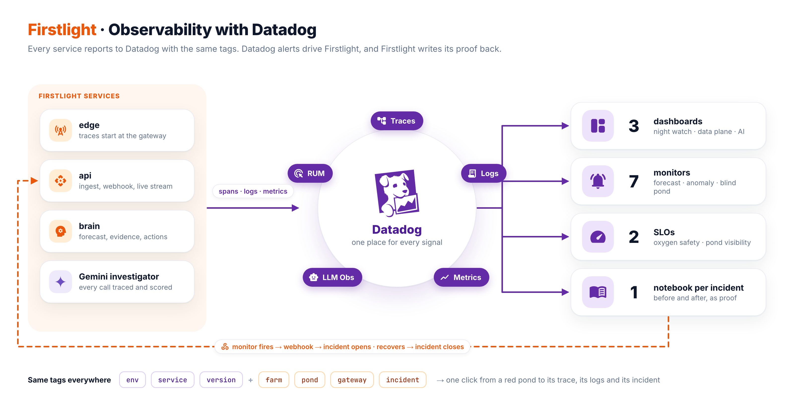

# Datadog observability

> **Status:** design baseline. Dashboards, monitors and SLOs are kept as JSON in `infra/datadog/` and applied by script, so they can be rebuilt in any Datadog org.



Datadog has two jobs in Firstlight:

- It watches the **software**: traces, logs and metrics from every service.
- It watches the **ponds**: low-cardinality signals derived in MongoDB, one series per pond or gateway.

Its monitors drive the incident workflow through a webhook. Firstlight writes the proof back as a notebook.

## Tags

Every metric, span, log, RUM event and LLM span carries the same tags. This is what makes "click a red pond, open its trace, its logs and its incident" work.

| Kind | Tags |
|---|---|
| Unified service tagging | `env`, `service` (`firstlight-edge`, `-api`, `-brain`, `-web`), `version` (git sha) |
| Business context | `farm`, `pond`, `gateway`, `incident_id` (when one is open) |

Business tags are set on the active span (`span.set_tag`) and bound to the logger, so a log line and its span share them.

## Getting data in

| Signal | How |
|---|---|
| Traces | `ddtrace` auto-instruments FastAPI, PyMongo and httpx. Gateways call the API with httpx, so one trace runs from the gateway, through the API, to MongoDB. The brain's jobs (forecast, evidence, verify) are custom spans. |
| Logs | JSON to stdout with `dd.trace_id` and `dd.span_id` injected. The Agent tails the containers. |
| Metrics | DogStatsD (UDP 8125) for pond and gateway metrics; APM trace metrics come for free. |
| RUM | Browser SDK in the console, with `allowedTracingUrls` so clicks link to backend traces. |
| LLM Observability | `ddtrace.llmobs`: `workflow`, `agent`, `tool`, `retrieval` and `llm` spans around the Gemini investigator, plus evaluations. |
| Deployments | `DD_VERSION` is the git sha, so Deployment Tracking draws a marker on every chart when the version changes. |

## Custom metrics

About 1,000 contexts: 200 ponds × 4 pond metrics, 50 gateways × 2 gateway metrics, plus a handful of totals. No per-sensor tags.

| Metric | Type | Tags | Used by |
|---|---|---|---|
| `firstlight.pond.do` | gauge | farm, pond | dashboards, M2 |
| `firstlight.pond.minutes_to_hypoxia` | gauge | farm, pond | M1, Night Watch |
| `firstlight.pond.aerators_off` | gauge | farm, pond | M6 |
| `firstlight.pond.freshness_seconds` | gauge | farm, pond, gateway | M3 |
| `firstlight.pond.safe_minutes`, `.fresh_minutes`, `.total_minutes` | count | farm, pond | SLOs |
| `firstlight.gateway.buffer_depth` | gauge | gateway | Data Plane |
| `firstlight.gateway.send_errors` | count | gateway | Data Plane |
| `firstlight.ingest.readings`, `.duplicates` | count | version | Data Plane |
| `firstlight.command.ack_latency_ms` | distribution | action | Data Plane |
| `firstlight.incident.lead_time_min`, `.mttr_min` | distribution | plane, cause | Night Watch |
| `firstlight.false_alarm.prevented` | count | cause | Night Watch |

## Monitors

All monitors notify `@webhook-firstlight`, and use `{{pond.name}}` and `{{gateway.name}}` in their messages.

| # | Monitor | Query (abridged) | Why it matters |
|---|---|---|---|
| M1 | Hypoxia forecast | `min(last_2m):min:firstlight.pond.minutes_to_hypoxia{env:demo} by {farm,pond} < 30` (warn < 45) | Fires on the forecast, before the pond is in danger. |
| M2 | DO anomaly | `avg(last_15m):anomalies(avg:firstlight.pond.do{env:demo} by {pond}, 'agile', 3, direction='below') >= 1` | Catches unusual nights that the trend misses. |
| M3 | Pond blind | `max(last_2m):max:firstlight.pond.freshness_seconds{env:demo} by {gateway} > 60` | Silence is a risk too. |
| M4 | Slow ingest | `percentile(last_5m):p95:trace.fastapi.request{service:firstlight-api,resource_name:post_/v1/ingest} > 0.5` | A slow backend makes ponds go blind. |
| M5 | Gateway reconnects | `logs("service:firstlight-edge status:error @evt:reconnect_failed").by("gateway").last("5m") > 3` | Separates a 4G problem from a backend problem. |
| M6 | Aerator off | `max(last_1m):max:firstlight.pond.aerators_off{env:demo} by {farm,pond} > 0` | Context for M1. |
| C1 | Composite | `M1 && M6` | Aerator failure with high confidence. |

The settings that keep monitors quiet are `require_full_window: false` for short windows, `evaluation_delay: 0`, `notify_no_data` only on M3, and `renotify_interval` 10 minutes. The anomaly monitor needs history: the simulator runs continuously so M2 has several days of data before the demo.

## SLOs

| SLO | Good events / total events | Target | Window |
|---|---|---|---|
| Oxygen safety, per pond | `firstlight.pond.safe_minutes` / `firstlight.pond.total_minutes` | 99.5 % | 7 days |
| Pond visibility | `firstlight.pond.fresh_minutes` / `firstlight.pond.total_minutes` | 99 % | 7 days |
| Ingest latency | ingest requests under 500 ms / all ingest requests | 99 % | 7 days |

Burn-rate alerts on the first two SLOs use the same webhook.

## Dashboards

| Dashboard | Widgets |
|---|---|
| **Night Watch** (business) | Host map of ponds by `minutes_to_hypoxia`; DO with forecast per farm; open incidents; lead time, MTTR, false alarms prevented; SLO widgets |
| **Data Plane** (system) | Ingest rate and p95 by `version` with deploy markers; freshness by gateway; gateway buffer depth; command ack latency; MongoDB span latency by collection; error logs |
| **AI Investigator** | LLM Observability: latency, tokens, cost per investigation; RCA accuracy from evaluations |

## The webhook

```json
{
  "alert_id": "$ALERT_ID",
  "transition": "$ALERT_TRANSITION",
  "title": "$EVENT_TITLE",
  "monitor": "$ALERT_METRIC",
  "pond": "$TAGS[pond]",
  "gateway": "$TAGS[gateway]",
  "link": "$LINK",
  "date": "$DATE"
}
```

The webhook sends a shared-secret header. The API checks it, inserts into `alerts` (unique on `alert_id + transition`), queues the job and returns 200 within milliseconds. Datadog times out at 15 s and retries on 5xx, so the handler never does the work inline.

## AI and agent observability

The investigator is a small, bounded agent: Gemini (`gemini-3.8-flash`, falling back to `gemini-3.5-flash`) with read-only tools and at most five tool rounds. It can propose an action but never execute one; the deterministic evidence engine and the playbook decide.

**What is traced, and how.** ddtrace 4.16 ships a Google GenAI integration (google-genai 1.21.1 or newer) that records every `generate_content` and `embed_content` call as an LLM Observability `llm` or `embedding` span with token counts, without extra code. The agent loop and its tools are wrapped with the LLM Observability decorators, so one incident produces one connected tree, linked to the brain's APM trace:

```
workflow   investigate(INC-0042)                 tags: incident_id, pond, cause, plane
└─ agent   investigator                          gemini-3.8-flash, max 5 tool rounds
   ├─ tool       get_evidence(INC-0042)          the nine deterministic checks
   ├─ embedding  gemini-embedding-2              auto-instrumented
   ├─ retrieval  similar_incidents               hybrid $vectorSearch + $search, documents and scores
   ├─ tool       query_datadog_logs(gateway)     read-only Datadog API
   ├─ llm        gemini-3.8-flash                auto-instrumented: prompt, output, tokens, latency
   └─ task       write_outputs                   RCA, Vietnamese farmer message, postmortem draft
```

**Evaluations**, submitted with `LLMObs.submit_evaluation` and joined to the workflow span:

| Evaluation | Type | How it is computed | Why it matters |
|---|---|---|---|
| `rca_correct` | score 0/1 | diagnosis compared with the fault the chaos panel injected | accuracy measured against ground truth, not opinion |
| `agrees_with_rules` | categorical | the agent's cause compared with the deterministic engine's | disagreement is flagged to a person instead of acted on |
| `grounded` | score 0–1 | share of evidence ids cited by the agent that exist in the bundle | catches invented evidence |
| `farmer_message_ok` | score 0/1 | Vietnamese, under 300 characters, names the pond and the action taken | the message a farmer reads at 2 a.m. stays short and actionable |

**Dashboard and monitors.** The AI Investigator dashboard shows latency, tokens and cost per investigation, the fallback-model rate and the four evaluations over time. A monitor alerts the operator, never the farmer, when `rca_correct` falls below 0.8 over the last 20 investigations or when the investigator error rate rises.

**Forecast quality.** Toto and the aggregation trend are machine-learning components as well: the brain publishes `firstlight.forecast.abs_error_min` (predicted versus actual minutes to the 3 mg/L line, by model) so forecast drift is visible next to the LLM metrics.

**Checked on the trial account before relying on them:** managed evaluations, LLM Observability Experiments, and the agent graph views. The design above works without any of them.

## Proof of recovery

When an incident resolves, the brain creates a notebook through `POST /api/v1/notebooks` containing:

- a summary cell with cause, actions, lead time, MTTR and oxygen debt;
- DO and `minutes_to_hypoxia` for the pond from 10 minutes before detection to 10 minutes after recovery;
- the ack latency of the commands sent;
- links to the incident's traces and logs.

The notebook link is stored on the incident.

## Before the trial ends

Datadog data from the trial does not outlive it. Dashboards and monitors are exported as JSON into `infra/datadog/`, the demo video is recorded during the build, and the apply script can recreate everything in another org.
