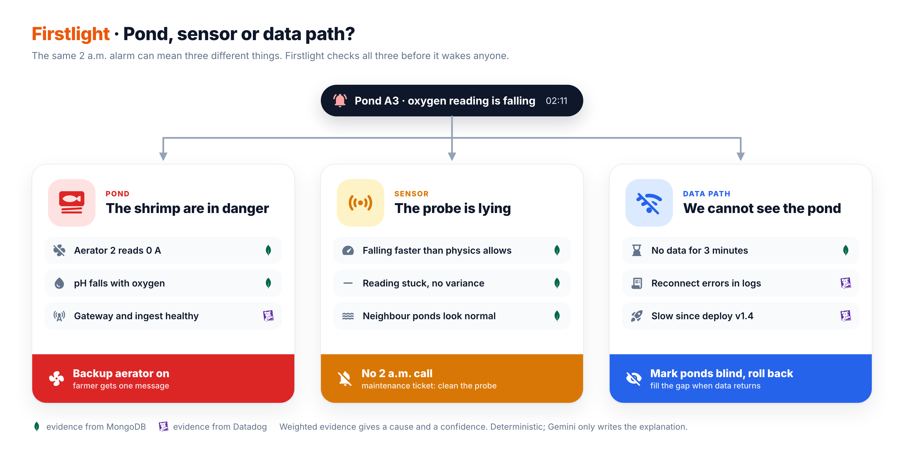
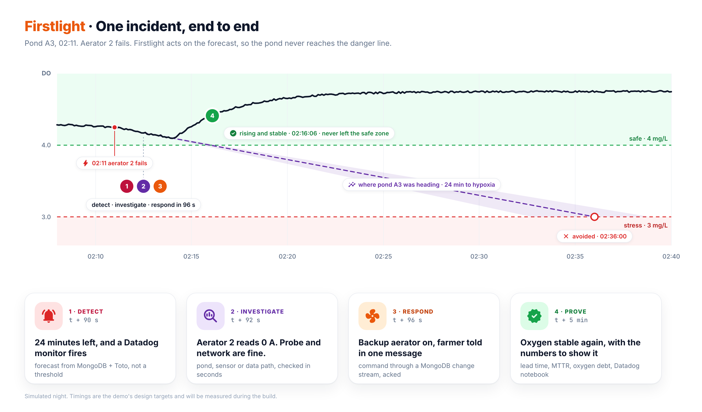

# Incident scenarios

> **Status:** scenarios 1, 2, 4 and 5 run on the demo host. The numbers below were measured there on 17 October 2026. During these runs the simulated farms ran 12 hours behind Vietnam time, so that an afternoon demo happened in their night: 03:19 in the tables was 15:19 in Vietnam. The console and the simulator now use Vietnam time. Scenario 3 is built and covered by the test suite, but has not been run on the demo host yet. Datadog monitors join when the trial is active. Until then the brain detects every incident itself, which is also how it behaves when Datadog, or the network to it, is down.

Firstlight's demo shows operational incidents from the moment they start to the moment they are resolved. Each one is triggered from the chaos panel and has a **real effect on the running system**: an aerator really stops in the simulator, a gateway's link is really cut, a farm really loses power. The incidents, commands, messages and recovery numbers are therefore the system's own data, not a recording. The pond values themselves are synthetic and come from the simulator's physics model.

## Overview

| # | Scenario | Plane | How it is triggered | Diagnosis | Response | Detected | Status |
|---|---|---|---|---|---|---|---|
| 1 | Aerator failure | Pond | the pond's largest aerator stops drawing current | `aerator_failure` | standby aerator on (auto) | 5 s | measured |
| 2 | Fouled DO probe | Sensor | biofilm builds on the probe; the water stays healthy | `sensor_fault` | nobody woken; cleaning ticket | 27 s | measured |
| 3 | Slow ingest after a deploy | Data path (backend) | release `firstlight-api` 1.4, whose new duplicate check scans `ingest_batches` on every batch | `ingest_regression` | message the engineer to roll back to 1.3 | | built, tested |
| 4 | Gateway offline | Data path (edge) | the gateway's 4G link is cut | `gateway_offline` | mark ponds blind; dispatch; check the gap | 64 s | measured |
| 5 | Farm power cut | Pond | every aerator on one farm stops at once | `power_outage` | generator, once a person approves | 10 s | measured |

The gateway offline scenario cannot be detected faster than its threshold: a pond counts as blind after 60 s without data.

---

## 1. Aerator failure

The figure shows the full design, including the Datadog monitor that joins once the trial is active. Measured run, incident INC-0001, pond BL-01-A3:

| Farm time | What happened | Where it shows |
|---|---|---|
| 03:19:22 | Aerator AE-BL-01-A3-1 stops. | `chaos`; simulator |
| 03:19:23 | The gateway's next batch carries 0 A for it. | `readings.aer[].amp` |
| 03:19:27 (+5 s) | INC-0001 opens and is diagnosed in the same brain cycle: aerator failure, 85% sure. For: the aerator drew 9.0 A, then 0 A (+0.85). Against: the probe reports signal quality 1.00 (sensor, −0.20), readings are 4 s old (data path, −0.20), the other ponds are steady (power cut, −0.30). | `incidents.evidence` |
| 03:19:27 | `aerator.on AE-BL-01-A3-S` goes into `commands`. The owner gets one message in Vietnamese, and a repair ticket opens. | `commands`; timeline |
| 03:19:28 (+1 s) | The gateway confirms the standby is turning. | ack; `firstlight.command.ack_latency_ms` |
| 03:19:37 | Verifying: DO must stay at or above 4 mg/L, and not fall, for 2 minutes after the action. | timeline |
| 03:21:37 | Resolved 2.2 minutes after the aerator stopped. Lowest DO 4.55 mg/L; the pond never went below 4 mg/L; oxygen debt 0. | `incidents.metrics` |
| later | The technician repairs AE-1: it draws current again, the repair ticket closes itself and the standby goes back to waiting. | timeline `ticket_closed` |

The message the owner received: *"Ao BL-01-A3: quạt AE-BL-01-A3-1 ngừng quay lúc 03:19. Firstlight đã bật quạt dự phòng AE-BL-01-A3-S. Oxy hiện 4,6 mg/L. Sáng mai nhờ kiểm tra quạt hỏng."* (Pond BL-01-A3: aerator AE-BL-01-A3-1 stopped at 03:19. Firstlight started standby aerator AE-BL-01-A3-S. Oxygen is 4.6 mg/L. Please check the broken aerator in the morning.)

While its repair ticket is open, the stopped aerator raises no new alarm. Another aerator stopping still does.

## 2. Fouled DO probe

Measured run, incident INC-0007, pond BT-03-A4:

| Farm time | What happened |
|---|---|
| 03:56:38 | Biofilm starts building on probe DO-BT-03-A4. The water stays healthy; only the reading falls. |
| 03:57:05 (+27 s) | INC-0007 opens because DO is falling faster than 0.1 mg/L per minute. The probe still reads 4.48 mg/L, so no threshold alarm would have fired yet. |
| 03:57:15 (+37 s) | Diagnosis: probe fault, 60% sure. DO reads −0.21 mg/L per minute with every aerator turning, faster than water can lose oxygen (+0.35). DO fell 0.6 mg/L in 3 minutes while pH, which follows real oxygen, did not move (+0.25). The incident closes as a false alarm: **nobody is woken up**, a ticket asks to clean the probe, and `firstlight.false_alarm.prevented` counts it. The pond shows as **sensor**, its reading struck through, and no forecast is made from it. |
| 03:58:05 | The probe is cleaned, reads normally again, and the ticket closes itself. |

An earlier run, before the 3-minute rate signal existed, needed 90 s and only caught the probe once it read 3.6 mg/L.

## 3. Slow ingest after a deploy

`scripts/release.sh 1.4 --regression` starts `firstlight-api` 1.4, and only the API container is recreated. The release adds a duplicate check based on the rule "a gateway never sends the same sequence number twice". The check looks up `ingest_batches` by `{gateway, seq}`, and no index covers that. Every batch therefore pays for a collection scan of a day of batches: `explain()` measured about 150 ms over 283,000 documents. Once ingest is slow enough for gateways to time out, they buffer, and ponds across the fleet turn **blind**. The run on the demo host will show how quickly that happens.

| What Firstlight sees | Where |
|---|---|
| More than half the gateways are silent at once, so the backend is at fault, not the 4G links (+0.7). | `pond_state` freshness |
| `firstlight-api` 1.4 started shortly before the data stopped, replacing 1.3 (+0.35). | `deployments`, written by the API on every start |
| With Datadog: ingest latency by `version` next to the deployment marker, and a MongoDB span showing the collection scan. | APM, Deployment Tracking |

The diagnosis is `ingest_regression`, an estate-wide incident. The engineer gets a message proposing to roll back to 1.3, which is one command: `scripts/release.sh 1.3`. The gateways then flush their buffers, and the gap check shows how much of the blind spell their backlog covered.

The test suite covers both halves:
- release 1.4's check finds duplicates by gateway and sequence;
- a fleet that goes silent just after a release is traced to that release and the version it replaced.

This scenario is a software incident in Firstlight itself, so every signal in it comes straight from the running system.

## 4. Gateway offline

Measured run, incident INC-0003, gateway GW-CM02-1:

| Farm time | What happened |
|---|---|
| 03:24:13 | GW-CM02-1's 4G link is cut. The gateway keeps sampling and buffers its batches. |
| 03:25:17 (+64 s) | After 60 s of silence, INC-0003 opens for the gateway and its 4 ponds. Diagnosis gateway offline, 80% sure: 4 ponds silent (+0.40), while 49 other gateways report normally, so ingest works (+0.40). The technician gets a message, and the ponds show as **blind**. |
| 03:26:27 | The link came back after 134 s. The buffered batches arrive in order and the blind spell is checked with `$densify`: every 20-second slot has readings (100% coverage), the lowest DO was 4.78 mg/L, and the failsafe had nothing to do. Resolved 12 s after the data returned. |

Had a pond read below 3.5 mg/L while the gateway was cut off, the gateway would have started its standby aerator itself and reported it with its next batch. The automated test `test_blind_gateway_is_watched_and_the_gap_checked_when_it_returns` covers exactly that.

## 5. Farm power cut

Measured run, incident INC-0004, farm KG-01:

| Farm time | What happened |
|---|---|
| 03:26:47 | Farm KG-01 loses grid power, and every aerator stops. |
| 03:26:57 (+10 s) | INC-0004 opens for the farm, 4 s after the first batch showed it. Diagnosis power cut, 100% sure: every aerator on the farm stopped at once (+0.90). The owner is asked to approve the generator, a step the playbook does not take on its own. |
| 03:27:58 | The operator approves in the console, 61 s after the request in this run. |
| 03:28:08 | The generator command goes out through the same command bus, the gateway confirms within a second, and the aerators turn again. |
| 03:30:57 | Resolved. Lowest DO 4.54 mg/L. |

---

## Ground truth and evaluation

The chaos registry (`chaos`) records every injected fault with its pond, device and start time. The brain never reads it while it investigates. In every measured run above, the diagnosis matched the injected fault. When the AI investigator lands, each resolved incident will be compared with the registry and scored as `rca_correct` in Datadog LLM Observability, and the demo will report the accuracy across all runs, not a single example.

## Outside demo mode

The same checks run on every real incident. Without a chaos registry there is no automatic score; instead the operator confirms or corrects the diagnosis in the console, and that answer becomes the evaluation.
