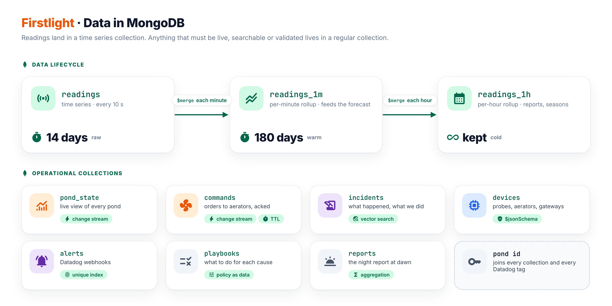

# MongoDB data model

> **Status:** design baseline. Pipelines are written for MongoDB 8.0 and were checked on `mongodb-atlas-local:8.0.34`, which runs on the demo host and includes Atlas Search and Vector Search. The same code runs on Atlas. Measured figures (ingest rate, compression, `explain()` output) are added once the system runs.



## Why this shape

| Need | Where it lives | Reason |
|---|---|---|
| Every reading, compressed, queried by pond and time | `readings`, a **time series** collection | Bucketed and column-compressed storage; 8.0 block processing speeds up the window functions that run every 30 s. |
| Something the console and gateways can subscribe to | `pond_state`, `commands`, `incidents` (regular collections) | Time series collections do not support change streams. |
| Exactly-once handling of retries | `ingest_batches`, `alerts` with unique indexes | Time series collections cannot carry a unique index. |
| Validation of device documents | `devices` with `$jsonSchema` | Time series collections do not support schema validation. |
| Searching past incidents by meaning | `incidents` with Atlas Vector Search and Atlas Search | Search indexes cannot be built on time series collections. |
| Cheap long-term history | `readings_1m`, `readings_1h`, built with `$merge` | `$merge` cannot write into a time series collection; rollups are regular collections with their own TTL. |

The pond id (`BL-01-A3`) is the join key everywhere. It appears in `readings.meta.pond`, `pond_state._id`, `devices.pond`, `commands.pond` and `incidents.pond`, and as the `pond` tag on every Datadog metric, span and log.

## Collections

### `readings`: time series

```js
db.createCollection("readings", {
  timeseries: { timeField: "ts", metaField: "meta", granularity: "seconds" },
  expireAfterSeconds: 14 * 24 * 3600
})
db.readings.createIndex({ "meta.pond": 1, ts: -1 })
```

One document per pond per tick carries every measurement for that tick. This produces fewer buckets and better compression than one document per sensor. The `meta` fields are stable identifiers only.

```js
{
  ts: ISODate("2026-10-20T19:11:00Z"),
  meta: { farm: "BL-01", pond: "BL-01-A3", gateway: "GW-BL01-1" },
  do: 4.21, temp: 29.4, ph: 7.62,
  aer: [ { id: "AE-1", on: true, amp: 6.1 }, { id: "AE-2", on: true, amp: 0.0 } ],
  probe: { id: "DO-A3", q: 0.98 },
  batch: "GW-BL01-1:000912"
}
```

### `pond_state`: computed pattern, change stream to the console

```js
{
  _id: "BL-01-A3", farm: "BL-01", gateway: "GW-BL01-1",
  status: "watch",                       // ok | watch | alert | sensor | blind
  last: { ts: ISODate("…"), do: 4.21, temp: 29.4, ph: 7.62, aerators_on: 3 },
  forecast: { at: ISODate("…"), linear_min: 31, toto_p10_min: 24, minutes_to_hypoxia: 24,
              p10: [ … ], p90: [ … ] },
  freshness_s: 12, open_incident: "INC-0042", updated_at: ISODate("…")
}
```

### `commands`: the command bus

```js
{
  _id: ObjectId("…"), gateway: "GW-BL01-1", pond: "BL-01-A3", device: "AE-5",
  action: "aerator.on", reason: "INC-0042", risk: "auto",
  status: "acked",                       // pending → sent → acked → done | failed | expired
  created_at: ISODate("…"), acked_at: ISODate("…"), expires_at: ISODate("…")
}
db.commands.createIndex({ gateway: 1, status: 1 })
db.commands.createIndex({ expires_at: 1 }, { expireAfterSeconds: 0 })
```

### `incidents`: what happened, what we did, what to do next time

```js
{
  _id: "INC-0042", pond: "BL-01-A3", farm: "BL-01", plane: "pond", status: "resolved",
  diagnosis: { cause: "aerator_failure", confidence: 0.93, device: "AE-2" },
  timeline: [ { t: ISODate("…"), kind: "detected", source: "datadog", alert_id: "…" },
              { t: ISODate("…"), kind: "action", command: ObjectId("…") }, … ],
  evidence: [ { check: "aerator_current_drop", verdict: "support", weight: 0.6,
                detail: "AE-2 6.1 → 0.0 A at 02:11", links: { mongo: "…", datadog: "…" } }, … ],
  metrics: { lead_time_min: 24, mttd_s: 90, mttr_min: 5.1, oxygen_debt: 0.0, min_do: 4.09 },
  summary: "Aerator 2 in pond A3 failed at 02:11 …", summary_vi: "…", postmortem_md: "…",
  ground_truth: { fault: "aerator_trip", device: "AE-2" }   // demo mode only, for evaluation
}
db.incidents.createIndex({ pond: 1, status: 1 })
```

When an incident resolves, the brain embeds its summary with Gemini (`gemini-embedding-2`, 768 dimensions, returned already normalised) and stores it in `embedding`. The model ignores the `taskType` parameter, so the task goes into the text: documents are embedded as `title: none | text: …` and queries as `task: search result | query: …`. On our own test set of 22 incidents and 18 English and Vietnamese queries, this kept top-1 accuracy at 100% and raised cross-language recall@3 from 0.06 to 0.62. Two search indexes cover the collection:

```json
// incident_vectors (vectorSearch)
{ "fields": [
    { "type": "vector", "path": "embedding", "numDimensions": 768, "similarity": "cosine" },
    { "type": "filter", "path": "status" },
    { "type": "filter", "path": "diagnosis.cause" } ] }

// incident_text (search)
{ "mappings": { "dynamic": false, "fields": {
    "summary": { "type": "string" }, "postmortem_md": { "type": "string" } } } }
```

On Atlas, automated embedding with Voyage AI can replace the Gemini step; the queries stay the same.

### Other collections

| Collection | Shape | Indexes and features |
|---|---|---|
| `devices` | `type` (`do_probe`, `aerator`, `feeder`, `generator`, `gateway`), `pond`, `farm`, and type-specific fields such as `aerator.kw` or `probe.cleaned_at` | `$jsonSchema` with `oneOf` per type; `2dsphere` on farm location |
| `alerts` | raw Datadog webhook: `alert_id`, `transition`, `monitor`, `pond`, `payload`, `received_at` | unique `{ alert_id: 1, transition: 1 }` |
| `ingest_batches` | `_id` = batch id, `received_at` | TTL 1 day on `received_at` |
| `stream_state` | `_id` = stream name, `token` | resume tokens for change streams |
| `readings_1m`, `readings_1h` | `_id { pond, minute or hour }`, `farm`, `do { avg, min, max }`, `temp`, `ph`, `n` | TTL 180 days on `minute`; no TTL on hourly |
| `playbooks` | `cause` → `steps [ { action, target, risk, escalate_after_min } ]` | unique on `cause` |
| `reports` | `{ farm, date }`, incidents, minimum DO per pond, SLO | unique `{ farm: 1, date: 1 }` |

## Aggregation pipelines

Each pipeline answers one operational question.

### How many minutes until this pond runs out of oxygen?

Least-squares slope of DO over the last 30 minutes, for every pond in one pass:

```js
db.readings.aggregate([
  { $match: { ts: { $gte: new Date(Date.now() - 30 * 60 * 1000) } } },
  { $set: { t: { $toLong: "$ts" } } },
  { $setWindowFields: {
      partitionBy: "$meta.pond", sortBy: { ts: 1 },
      output: {
        cov:  { $covariancePop: ["$t", "$do"], window: { documents: ["unbounded", "current"] } },
        sd_t: { $stdDevPop: "$t",              window: { documents: ["unbounded", "current"] } },
        do_1m: { $avg: "$do", window: { range: [-60, 0], unit: "second" } }
      } } },
  { $group: { _id: "$meta.pond",
      last: { $top: { sortBy: { ts: -1 }, output: { ts: "$ts", do: "$do_1m", cov: "$cov", sd_t: "$sd_t" } } } } },
  { $set: { slope_per_min: { $multiply: [ { $divide: ["$last.cov", { $pow: ["$last.sd_t", 2] }] }, 60000 ] } } },
  { $set: { linear_min: { $cond: [ { $lt: ["$slope_per_min", -0.005] },
      { $divide: [ { $subtract: ["$last.do", 3.0] }, { $multiply: ["$slope_per_min", -1] } ] },
      null ] } } }
])
```

### Did the DO slope change when an aerator stopped?

```js
{ $setWindowFields: { partitionBy: "$meta.pond", sortBy: { ts: 1 },
    output: { do_rate: { $derivative: { input: "$do", unit: "minute" },
                         window: { range: [-120, 0], unit: "second" } } } } }
```

The evidence check compares the minute where `do_rate` turns sharply negative with the minute where an aerator's `amp` drops to 0.

### Is the probe stuck?

```js
{ $setWindowFields: { partitionBy: "$meta.pond", sortBy: { ts: 1 },
    output: { sd_5m: { $stdDevPop: "$do", window: { range: [-300, 0], unit: "second" } } } } },
{ $match: { sd_5m: { $lt: 0.005 } } }
```

### How much stress did the shrimp take? (oxygen debt)

```js
db.readings.aggregate([
  { $match: { "meta.pond": "BL-01-A3", ts: { $gte: start, $lte: end } } },
  { $set: { deficit: { $max: [0, { $subtract: [4, "$do"] }] } } },
  { $setWindowFields: { sortBy: { ts: 1 },
      output: { debt: { $integral: { input: "$deficit", unit: "minute" },
                        window: { documents: ["unbounded", "current"] } } } } },
  { $group: { _id: null, oxygen_debt: { $max: "$debt" }, min_do: { $min: "$do" } } }
])
```

### What happened while a gateway was offline?

```js
db.readings.aggregate([
  { $match: { "meta.gateway": "GW-BL02-1", ts: { $gte: from, $lt: to } } },
  { $densify: { field: "ts", partitionByFields: ["meta.pond"],
                range: { step: 10, unit: "second", bounds: [from, to] } } },
  { $fill: { partitionByFields: ["meta.pond"], sortBy: { ts: 1 },
             output: { do: { method: "linear" } } } }
])
```

### Rollups for the data lifecycle

```js
db.readings.aggregate([
  { $match: { ts: { $gte: minuteStart, $lt: minuteEnd } } },
  { $group: {
      _id: { pond: "$meta.pond", minute: { $dateTrunc: { date: "$ts", unit: "minute" } } },
      farm: { $first: "$meta.farm" },
      do_avg: { $avg: "$do" }, do_min: { $min: "$do" }, do_max: { $max: "$do" },
      temp: { $avg: "$temp" }, ph: { $avg: "$ph" }, n: { $sum: 1 } } },
  { $set: { minute: "$_id.minute" } },
  { $merge: { into: "readings_1m", on: "_id", whenMatched: "replace", whenNotMatched: "insert" } }
])
```

### Have we seen this before?

Hybrid search: vector similarity and keyword relevance, merged with Reciprocal Rank Fusion. `$rankFusion` is not enabled on 8.0, so the fusion is written with `$unionWith`, which runs on any 8.0 deployment:

```js
const k = 60                      // RRF constant
const rank = [                    // turn a ranked list into 1 / (k + rank)
  { $group: { _id: null, ids: { $push: "$_id" } } },
  { $unwind: { path: "$ids", includeArrayIndex: "r" } },
  { $project: { _id: "$ids", score: { $divide: [1, { $add: ["$r", k + 1] }] } } }
]
db.incidents.aggregate([
  { $vectorSearch: { index: "incident_vectors", path: "embedding", queryVector: qv,
                     numCandidates: 100, limit: 10, filter: { status: "resolved" } } },
  ...rank,
  { $unionWith: { coll: "incidents", pipeline: [
      { $search: { index: "incident_text", text: { query: q, path: ["summary", "postmortem_md"] } } },
      { $limit: 10 }, ...rank ] } },
  { $group: { _id: "$_id", score: { $sum: "$score" } } },
  { $sort: { score: -1 } }, { $limit: 3 },
  { $lookup: { from: "incidents", localField: "_id", foreignField: "_id", as: "incident" } },
  { $unwind: "$incident" }
])
```

`qv` is the Gemini embedding of the open incident's evidence summary, and `q` is the same text.

## Change streams

| Stream | Filter | Consumer |
|---|---|---|
| `pond_state` | `update`, `replace` | API → console (SSE) |
| `incidents` | `insert`, `update` | API → console (SSE) |
| `commands` | `insert` with `status: "pending"` | API → the gateway's SSE channel |

Each consumer stores its resume token in `stream_state` after every event and passes `resume_after` on restart. The API opens one stream per collection and fans out in memory, so the connection count does not grow with the number of gateways.

## Measurements to publish

These are filled in from the running system:

- readings per second sustained by `insert_many` batches;
- `db.readings.stats().timeseries` compression compared with an equivalent regular collection;
- `explain("executionStats")` for the forecast pipeline and the evidence queries, showing index use;
- p95 latency of the forecast pipeline for 200 ponds.
