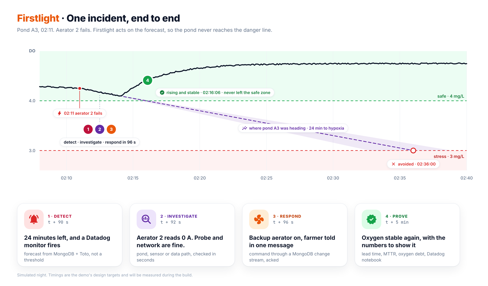
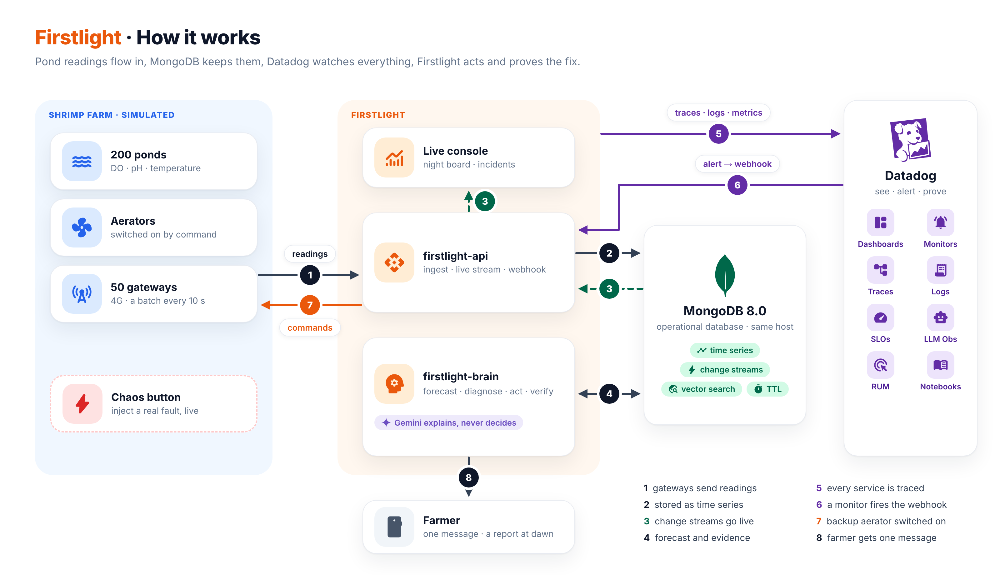
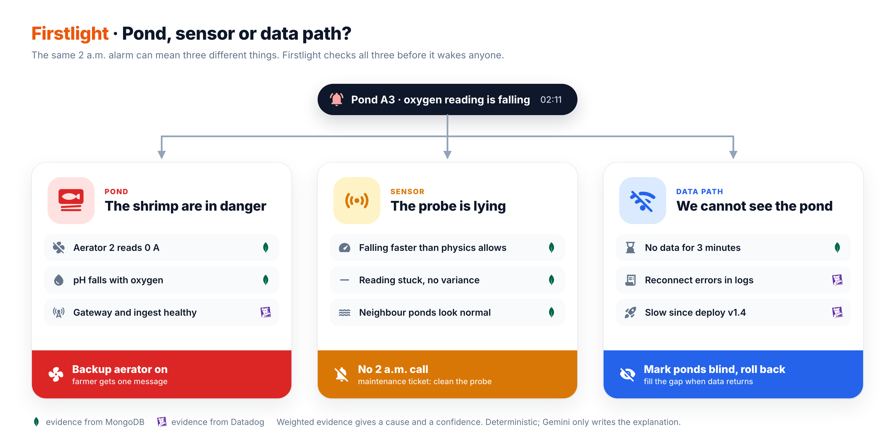
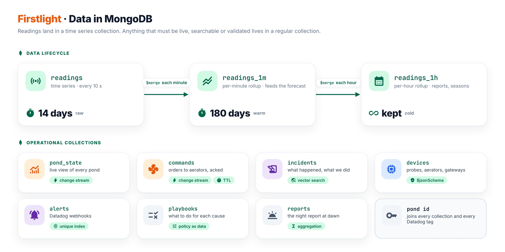
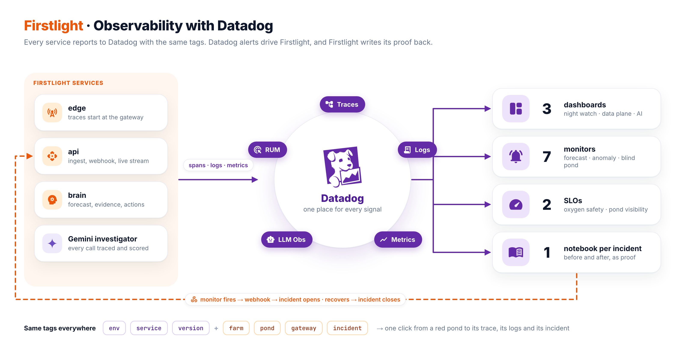
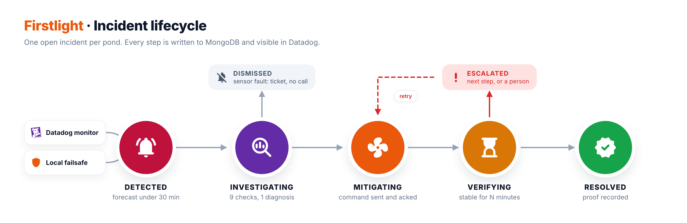
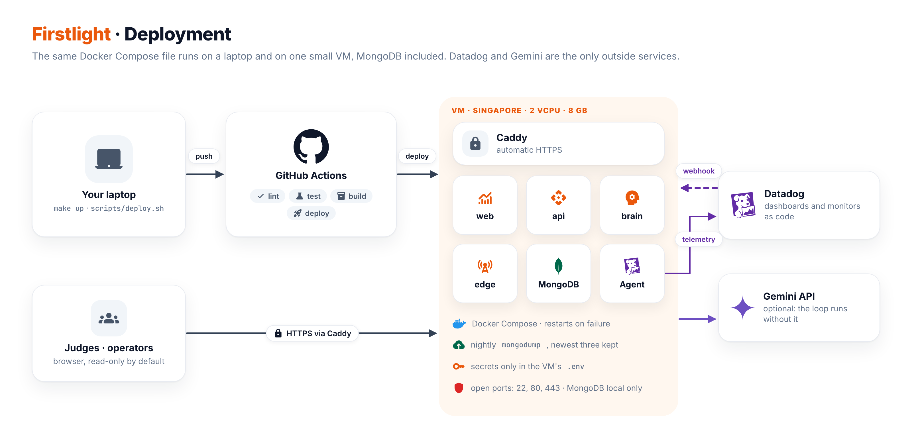

# Firstlight documentation

| Document | What it answers |
|---|---|
| [Architecture](ARCHITECTURE.md) | What the system is made of, how data and incidents flow through it, how it fails safely and how it is deployed. |
| [MongoDB data model](MONGODB-DATA-MODEL.md) | Which collections exist and why, the documents, the indexes, the data lifecycle and the aggregation pipelines. |
| [Datadog observability](DATADOG-OBSERVABILITY.md) | Tags, metrics, monitors, SLOs, dashboards, the webhook, LLM Observability and the recovery notebook. |
| [Incident scenarios](INCIDENT-SCENARIOS.md) | The five incidents the demo triggers, what each one looks like and how it is resolved. |
| [Declaration](DECLARATION.md) | What existed before the build window, reused components, data and AI tools. |

## Diagrams

| | |
|---|---|
|  One incident, end to end |  How it works |
|  Pond, sensor or data path? |  Data in MongoDB |
|  Observability with Datadog |  Incident lifecycle |
|  Deployment | |
